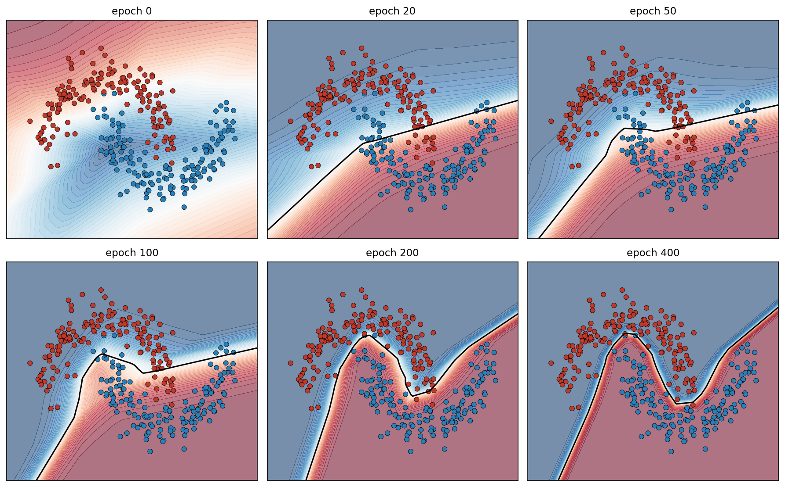

# Backpropagation

A small multi-layer perceptron (MLP) implemented from scratch with NumPy. Forward pass, backpropagation (gradient of the loss function and the chain rule) and weight updates. The picture below shows visualisation of how the decision boundary evolves during training.



---

## Relation to AI

Backpropagation is the algorithm that makes neural networks trainable.  
It is used to train **every** modern architecture:

- Convolutional Neural Networks (CNNs) for image recognition
- Transformers / large language models (the gradients flow through attention and MLP blocks)
- Diffusion models (the noise-prediction network is trained with backprop)
- Reinforcement-learning policies, speech models, etc.

When you call `loss.backward()` in PyTorch or JAX, the framework is executing exactly the same chain-rule calculations that are derived by hand in this project — just for much deeper graphs and with automatic differentiation.

## Running

```bash
pip install -r requirements.txt
python main.py
```

The script:

1. Generates 2-D “two moons” data
2. Checks the analytic gradient against numerical central differences
3. Trains the network for 400 epochs
4. Saves `decision_boundaries.png` (boundary at epochs 0, 20, 50, 100, 200, 400) and `loss_curve.png`

## Network architecture

```
x ∈ ℝ²  →  Linear → ReLU  →  Linear → ReLU  →  Linear → sigmoid  →  ŷ ∈ (0,1)
         W1,b1          W2,b2          W3,b3
```

Loss is binary cross-entropy:

$$L = -\frac1N\sum_{i=1}^N \Bigl[ y_i\log\hat y_i + (1-y_i)\log(1-\hat y_i) \Bigr]$$

## Mathematics – chain rule by hand

Denote the layers from bottom to top. Forward pass:

$$
\begin{aligned}
z^{(1)} &= X W^{(1)} + b^{(1)}, & a^{(1)} &= \operatorname{ReLU}(z^{(1)}) \\
z^{(2)} &= a^{(1)} W^{(2)} + b^{(2)}, & a^{(2)} &= \operatorname{ReLU}(z^{(2)}) \\
z^{(3)} &= a^{(2)} W^{(3)} + b^{(3)}, & \hat y = a^{(3)} &= \sigma(z^{(3)})
\end{aligned}
$$

### Output layer (sigmoid + BCE)

The combination of sigmoid and binary cross-entropy simplifies nicely:

$$
\frac{\partial L}{\partial z^{(3)}} = \frac1N\,(\hat y - y)
$$

From this we obtain the weight gradients:

$$
\frac{\partial L}{\partial W^{(3)}} = (a^{(2)})^\top \frac{\partial L}{\partial z^{(3)}}, \qquad
\frac{\partial L}{\partial b^{(3)}} = \sum_i \frac{\partial L}{\partial z^{(3)}_i}
$$

and the error is sent backwards:

$$
\frac{\partial L}{\partial a^{(2)}} = \frac{\partial L}{\partial z^{(3)}} (W^{(3)})^\top
$$

### Hidden layer (ReLU)

The derivative of ReLU is the indicator function:

$$
\frac{\partial a^{(2)}}{\partial z^{(2)}} = \mathbf{1}_{z^{(2)} > 0}
$$

Therefore

$$
\frac{\partial L}{\partial z^{(2)}} = \frac{\partial L}{\partial a^{(2)}} \odot \mathbf{1}_{z^{(2)} > 0}
$$

and, as above:

$$
\frac{\partial L}{\partial W^{(2)}} = (a^{(1)})^\top \frac{\partial L}{\partial z^{(2)}}, \qquad
\frac{\partial L}{\partial a^{(1)}} = \frac{\partial L}{\partial z^{(2)}} (W^{(2)})^\top
$$

The first hidden layer is treated identically (replace $a^{(1)}$ by the input $X$).

### Summary – one backward pass

1. $\delta^{(3)} = (\hat y - y)/N$
2. $dW^{(3)} = (a^{(2)})^\top\delta^{(3)}$, $db^{(3)}=\sum\delta^{(3)}$
3. $\delta^{(2)} = (\delta^{(3)}(W^{(3)})^\top)\odot\mathbf{1}_{z^{(2)}>0}$
4. $dW^{(2)} = (a^{(1)})^\top\delta^{(2)}$, $db^{(2)}=\sum\delta^{(2)}$
5. $\delta^{(1)} = (\delta^{(2)}(W^{(2)})^\top)\odot\mathbf{1}_{z^{(1)}>0}$
6. $dW^{(1)} = X^\top\delta^{(1)}$, $db^{(1)}=\sum\delta^{(1)}$

Weights are updated by gradient descent: $W \leftarrow W - \eta\,dW$.

## Gradient checking

`main.py` compares the analytic gradient with the numerical approximation

$$
\frac{\partial L}{\partial \theta_i} \approx \frac{L(\theta + h e_i) - L(\theta - h e_i)}{2h}
$$

Relative error is typically below $10^{-6}$. If it grows, there is a bug somewhere.

## What the figure shows

At the beginning the decision boundary is essentially random (epoch 0). After roughly 20–50 epochs the network starts to separate the two moons, and by epoch 200 the boundary is already smooth. A ReLU network can learn a non-linear boundary that a single linear classifier could never produce.

## References

- Rumelhart, Hinton & Williams (1986), *Learning representations by back-propagating errors*
- Goodfellow, Bengio & Courville, *Deep Learning*, Chapter 6.5
- CS231n, Stanford – Backpropagation notes
